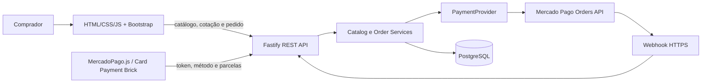

# Arquitetura

## Componentes

É um monólito modular: a API também serve o frontend no mesmo domínio. Não há contas de comprador, microserviços nem painel administrativo.

## Fluxo de compra

1. `GET /api/products` devolve somente produtos e variantes ativos/disponíveis.
2. O comprador configura uma ou mais linhas. Configurações diferentes ficam em linhas diferentes, mesmo que usem a mesma variante.
3. `POST /api/checkout/quote` recalcula os valores no backend e valida disponibilidade e personalização. A cotação é apenas para exibição; não cria pedido nem reserva estoque.
4. O comprador informa os dados e confere o resumo.
5. O Card Payment Brick recebe o valor cotado, o e-mail e o CPF para preencher os campos do pagador quando suportado.
6. Na submissão do Brick, `POST /api/orders` revalida tudo, grava o pedido e a primeira tentativa numa transação, reserva estoque controlado e chama o Mercado Pago fora da transação SQL.
7. Uma resposta de pagamento pendente é acompanhada pelo estado da API e webhook. O navegador nunca marca o pedido como pago.

## Pagamentos e idempotência

- O domínio depende de `PaymentProvider`; `MercadoPagoProvider` encapsula o SDK e o formato da Orders API.
- Cada ordem externa recebe `external_reference` aleatória e `X-Idempotency-Key` persistida.
- `Idempotency-Key` recebido pela API é único dentro da sessão. A sessão anônima HTTP-only é compartilhada entre abas; uma ordem ainda ativa impede nova tentativa de criação.
- A chave da tentativa local não cria uma segunda cobrança. Uma tentativa pendente ou em reconciliação bloqueia nova tentativa até que o estado seja conhecido.
- Tokens de cartão não são persistidos nem registrados em log.
- Falha definitiva libera reserva de estoque. Uma tentativa aprovada transforma a reserva em estoque vendido. Retentativa após recusa reserva novamente e verifica disponibilidade.

## Modelo de dados

- `products`: famílias Ônibus e Camiseta, com estado ativo.
- `product_variants`: opções comerciais/estoque/preço; preço em centavos.
- `checkout_options`: valores opcionais de turma e modalidade.
- `restricted_numbers` e `restricted_name_patterns`: regras configuráveis servidas pelo PostgreSQL.
- `checkout_sessions`: hashes de segredo e CSRF; nenhuma conta é criada.
- `customers`: dados necessários para cumprir a compra; CPF/RG cifrados por campo.
- `orders` / `order_items`: estados, totais e snapshots de preço/produto/variante.
- `payments`: uma linha por tentativa, identificadores Mercado Pago, parcelas e estado.
- `payment_events`: ID do evento, resumo não sensível e resultado de processamento; o corpo completo do webhook não é persistido.

As linhas de pedido preservam os valores do momento da compra. IDs públicos são referências aleatórias, não IDs sequenciais.

## Estados

`orders.status` e `payments.status` são distintos.

- Pedido: `AWAITING_PAYMENT`, `PAID`, `CANCELLED`, `EXPIRED`, `REFUNDED`, `PARTIALLY_REFUNDED`, `DISPUTED`.
- Tentativa: `SUBMITTING`, `PENDING`, `APPROVED`, `REJECTED`, `CANCELLED`, `EXPIRED`, `RECONCILING`, `ERROR`, `REFUNDED`, `PARTIALLY_REFUNDED`, `CHARGEDBACK`.

No mapeamento do Mercado Pago, `processed` + `accredited` só vira `APPROVED` depois de conferir referência, valor e moeda. `failed` é recusa; `action_required`, `processing` e `created` permanecem pendentes. Status desconhecido vira `RECONCILING`, nunca aprovado.

## Estoque e dados comerciais ausentes

As famílias de produto do seed começam inativas e sem variantes, porque preço, ônibus, tamanhos e estoque não foram informados. Não é possível pagar até que as opções sejam configuradas. O limite de quantidade por item é um limite técnico de requisição e pode ser ajustado com `MAX_ORDER_ITEM_QUANTITY`.

`expires_at` permanece nulo quando não houver política comercial de validade. Pedidos ainda aguardando o Mercado Pago permanecem reservados até atualização confiável ou definição de prazo operacional.
