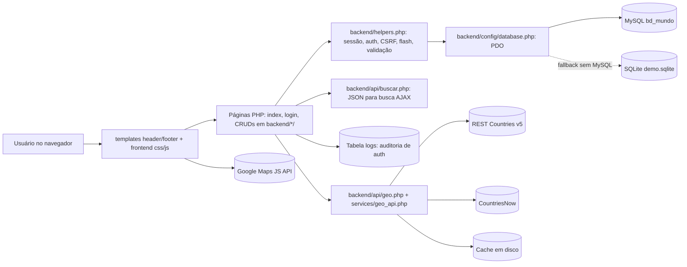

# CRUD Mundo — Sistema de gerenciamento de países, cidades, continentes e governantes

> **Projeto:** CRUD Mundo — aplicação web (front end + back end + banco de dados) para gerenciar informações geográficas do mundo.
> **Disciplina:** Programação Web · **Curso:** Desenvolvimento de Sistemas — São José dos Campos

> 🚀 **Professor, para rodar o sistema:** veja [Como executar (passo a passo)](#como-executar-passo-a-passo-para-o-professor) — XAMPP → `htdocs` → importar `database/bd_mundo.sql` → login `admin` / `Mundo@123`.

---

## Sobre o projeto

O CRUD Mundo é um sistema web que centraliza o cadastro e a consulta de **continentes, países, cidades e governantes** em um único lugar, com dados relacionados e consistentes. O sistema implementa as quatro operações do **CRUD** (Create, Read, Update, Delete) para as quatro entidades, com autenticação por sessão e painel inicial com estatísticas.

| Entidade | Campos | Relacionamentos |
|---|---|---|
| **Continentes** | nome, população, área (km²), total de países | possui vários países (1:N) |
| **Países** | nome, população, área (km²), idioma, clima, regime político, moeda | pertence a um continente; tem um governante; possui várias cidades |
| **Cidades** | nome, população, área (km²), clima, data de fundação | pertence a um país; pode ter um governante |
| **Governantes** | nome, partido, nascimento, idade, início e fim do mandato | governa um país **ou** uma cidade |

## Problema

Manter informações geográficas espalhadas (listas soltas, planilhas ou cadastros isolados) gera duplicidade, vínculos quebrados (ex.: cidade sem país, país sem continente) e exclusões perigosas que deixam dados "órfãos". O projeto resolve isso com um cadastro relacional único, com chaves estrangeiras, validações no front end e no back end, e regras claras de integridade referencial.

## Objetivos

**Objetivo geral:** disponibilizar uma aplicação web funcional para cadastrar, listar, editar e excluir continentes, países, cidades e governantes com integridade referencial e experiência de uso simples.

**Objetivos específicos:**

- Modelar o banco `bd_mundo` com PKs, FKs e dados iniciais de demonstração.
- Implementar CRUD completo das 4 entidades com PDO e prepared statements.
- Proteger as rotas com autenticação por sessão, troca obrigatória de senha no primeiro acesso e bloqueio após 3 tentativas inválidas.
- Oferecer busca dinâmica, filtro instantâneo, validações JS + PHP e estatísticas no painel inicial.

## Funcionalidades

### Implementado

Confirmado por leitura do código em `index.php`, `login.php`, `logout.php`, `backend/`, `templates/` e `frontend/`:

- Cadastrar, listar, editar e excluir as **4 entidades** (`backend/continentes/`, `backend/paises/`, `backend/governantes/`, `backend/cidades/` — cada uma com `index.php`, `form.php`, `excluir.php`).
- Filtro instantâneo nas listagens (JavaScript — `frontend/js/app.js`).
- Validação de formulários no **front end** (JS) e no **back end** (PHP — `backend/helpers.php`: `obrigatorio()`, `numero()`, `inteiro()`, `dataOpcional()`).
- Modal de **confirmação de exclusão** (`templates/footer.php` + `app.js`, formulários com `data-confirmar`).
- Mensagens de feedback (flash via sessão, padrão Post/Redirect/Get).
- Idade do governante calculada automaticamente a partir da data de nascimento (JS).
- **Integridade referencial:** excluir continente com países e excluir país com cidades é **bloqueado** (`ON DELETE RESTRICT` + verificação em PHP); excluir governante é **permitido** e apenas desvincula (`ON DELETE SET NULL`).
- Autenticação por sessão com logout e proteção das páginas (`login.php`, `logout.php`, `exigirAutenticacao()`).
- Bloqueio persistente da conta após 3 tentativas consecutivas de senha inválida (colunas `tentativas_falhas`/`bloqueado` em `usuarios`).
- Troca obrigatória de senha no primeiro acesso (`primeiro_acesso`) e alteração voluntária (`backend/auth/senha.php`).
- Auditoria de autenticação e alteração de senha na tabela `logs` (sem gravar senha ou hash).
- Proteção CSRF nos formulários POST e escaping de saída HTML (`e()`).
- Busca dinâmica global (AJAX) de países e cidades (`backend/api/buscar.php` + `fetch()` no `app.js`).
- Estatísticas no painel inicial (`index.php`): cidade mais populosa, cidades por continente, cidade mais populosa de cada país.

- **Aba 📍 Mapa (Google Maps):** `mapa.php` + `frontend/js/mapa.js` — marcadores com a bandeira de cada país cadastrado, balão com os dados e atalho para o cadastro, lista lateral com busca e filtro por continente e um pino 🎓 da **ETEC (Etec Profª Ilza Nascimento Pintus, Parque Residencial Aquarius — São José dos Campos)** com "Como chegar".
- **Aba 🌐 API Países (REST Countries + CountriesNow):** `explorador.php` + `backend/api/geo.php` + `backend/services/geo_api.php` — valida se os países e cidades cadastrados existem, mostra bandeiras e dados atualizados, tem validador manual de país/estado/cidade e um explorador de todos os países, estados e cidades.

- **Layout responsivo e efeitos visuais:** `frontend/css/ajustes.css` + `frontend/js/efeitos.js` — o topo se adapta a qualquer largura (menu em uma linha no desktop e "hambúrguer" abaixo de 1180 px, sem estourar a página), tamanhos reduzidos e, em JavaScript puro: barra de progresso da rolagem, topo que encolhe ao rolar, itens que aparecem suavemente, contagem animada nos números do painel, brilho que segue o mouse e leve inclinação 3D nos cartões, onda (*ripple*) nos botões, botão "voltar ao topo" e transição suave entre páginas. Respeita a preferência do sistema por menos movimento (`prefers-reduced-motion`).

### Em desenvolvimento

Nenhum item em desenvolvimento foi identificado no código atual — todo o escopo acima está implementado.

### Planejado

- Adicionar prints das telas principais (início, listagem, formulário, modal de exclusão) a esta documentação após rodar o projeto — pendência herdada da documentação anterior, não é funcionalidade de código.

## Tecnologias utilizadas

Somente tecnologias com uso confirmado no repositório:

- **Front end:** HTML5 semântico, CSS3 (responsivo, sem frameworks), JavaScript vanilla (sem frameworks).
- **Back end:** PHP 8+ com **PDO** (prepared statements em todas as queries).
- **Banco de dados:** MySQL/MariaDB (`bd_mundo`, script em `database/bd_mundo.sql`); SQLite local apenas como **modo demonstração** automático (`database/demo.sqlite`, gerado em tempo de execução quando o MySQL não está disponível).
- **APIs externas (abas Mapa e API Países):** Google Maps JavaScript API, REST Countries v5 e CountriesNow, consumidas via cURL no PHP (cache em disco) e `fetch()` no navegador.
- **Versionamento e documentação:** Git + GitHub, Markdown em `docs/`.

Não são utilizados frameworks PHP/JS, ORM, ML Engine, CI/CD ou qualquer outro componente além dos listados acima. As bibliotecas do Google Maps e as APIs de países são serviços externos acessados pela internet.

## Arquitetura

Arquitetura real do repositório (sem componentes inventados):



Responsabilidades:

- **Interface (`templates/`, `frontend/`):** layout compartilhado, visual responsivo, interações JS (modal, filtro, busca, validações).
- **Páginas e CRUDs (`index.php`, `login.php`, `logout.php`, `backend/continentes|paises|governantes|cidades/`, `backend/auth/senha.php`):** regras de apresentação, formulários, listagens com `LEFT JOIN`, exclusões com verificação prévia.
- **Apoio (`backend/helpers.php`):** sessão segura, autenticação, CSRF, flash, leitura de POST, validações, formatação.
- **API interna (`backend/api/buscar.php`):** endpoint JSON simples (países e cidades por nome) consumido pelo `fetch()` — não é uma API pública externa.
- **Integração com APIs (`backend/api/geo.php`, `backend/services/geo_api.php`, `backend/config/apis.php`):** o servidor consulta REST Countries e CountriesNow, normaliza as respostas, aplica cache e valida países/estados/cidades; o navegador só fala com o `geo.php`.
- **Banco (`database/bd_mundo.sql`, `backend/config/semente.php`):** esquema MySQL de entrega + seed idêntico para o modo demonstração SQLite.
- **Documentação de construção (`docs/ETAPA1.md`, `ETAPA2.md`, `ETAPA3.md`):** como o sistema foi construído em 3 etapas.

## Estrutura do projeto

A pasta real deste projeto no repositório é `PW-5-CRUD!/`. Ao copiar para o `htdocs` do XAMPP, sugere-se renomeá-la para `crud-mundo` (os exemplos de URL abaixo usam esse nome).

```
PW-5-CRUD!/
├── index.php                  ← painel inicial (dashboard + estatísticas, exige login)
├── login.php / logout.php     ← autenticação e encerramento da sessão
├── mapa.php                   ← aba Mapa (Google Maps + ETEC)
├── explorador.php             ← aba API Países (validação, validador manual, explorador)
├── database/
│   └── bd_mundo.sql           ← script de criação do banco + dados iniciais (MySQL)
├── backend/
│   ├── helpers.php            ← funções comuns (sessão, auth, CSRF, flash, validação…)
│   ├── config/
│   │   ├── database.php       ← conexão PDO (MySQL; fallback SQLite demo)
│   │   ├── semente.php        ← seed usado apenas no modo demonstração
│   │   ├── maps.php           ← chave do Google Maps + dados da ETEC
│   │   ├── apis.php           ← chave/URLs do REST Countries e CountriesNow, cache, SSL
│   │   └── coordenadas.php    ← países em português → ISO + coordenadas (mapa e validação)
│   ├── services/geo_api.php   ← cliente das APIs (cURL), cache e regras de validação
│   ├── auth/senha.php         ← troca obrigatória ou voluntária de senha
│   ├── api/buscar.php         ← endpoint JSON da busca dinâmica
│   ├── api/geo.php            ← endpoint JSON da aba API Países
│   ├── continentes/           ← index.php, form.php, excluir.php
│   ├── paises/                ← index.php, form.php, excluir.php
│   ├── governantes/           ← index.php, form.php, excluir.php
│   └── cidades/               ← index.php, form.php, excluir.php
├── frontend/
│   ├── css/style.css          ← todo o visual (responsivo)
│   ├── css/mapa.css           ← estilos da aba Mapa
│   ├── css/explorador.css     ← estilos da aba API Países
│   ├── css/ajustes.css        ← responsividade do topo (menu de 7 abas), escala menor, polimento visual e estilos dos efeitos
│   └── js/
│       ├── app.js             ← validações, modal, filtro, busca dinâmica…
│       ├── efeitos.js         ← efeitos visuais em JS puro (rolagem, contagem, brilho, ripple…)
│       ├── mapa.js            ← Google Maps, marcadores, lista lateral
│       └── explorador.js      ← validação dos cadastros, validador manual, explorador
├── templates/
│   ├── header.php             ← topo, menu, busca global, dados da sessão
│   └── footer.php             ← rodapé, faixa demo, modal de exclusão
└── docs/
    ├── ETAPA1.md              ← fundação: banco, PDO, CRUD de continentes
    ├── ETAPA2.md              ← núcleo relacional + integridade
    └── ETAPA3.md              ← interface, JS, busca, estatísticas, entrega
```

## Requisitos

- **XAMPP** (Apache + MySQL/MariaDB) **ou** PHP 8+ com extensões `pdo_mysql` (uso real) e `pdo_sqlite` (apenas modo demonstração) + MySQL/MariaDB.
- Navegador moderno com JavaScript habilitado (busca AJAX, modal, filtro).
- Acesso ao phpMyAdmin (ou cliente MySQL) para importar `database/bd_mundo.sql` no modo com MySQL.
- Para o modo demonstração rápido (sem banco): apenas PHP (o sistema cria o SQLite automaticamente).
- **Internet** apenas para as abas **Mapa** e **API Países** (extensão `curl` do PHP, já ativa no XAMPP; chave do Google Maps; chave gratuita opcional do REST Countries).

## Como executar (passo a passo para o professor)

> **Resumo:** ligar o XAMPP → copiar a pasta para o `htdocs` → importar o SQL no phpMyAdmin → abrir o endereço → entrar com `admin` / `Mundo@123`.

### Windows (XAMPP)

1. **Ative o XAMPP.** Abra o *XAMPP Control Panel* e clique em **Start** em **Apache** e em **MySQL** (os dois devem ficar com fundo verde).
2. **Coloque o projeto no `htdocs`.** Copie a pasta do projeto para `C:\xampp\htdocs\` e renomeie-a para **`crud-mundo`** (o resultado é `C:\xampp\htdocs\crud-mundo\`; qualquer nome sem espaços ou `!` também funciona, mas então a URL muda).
3. **Rode o SQL.** Acesse **http://localhost/phpmyadmin** → aba **Importar** → *Escolher arquivo* → selecione `database/bd_mundo.sql` → clique em **Importar** (no fim da página). O script cria o banco `bd_mundo`, as tabelas, os dados de exemplo e o usuário `admin`.
4. **Abra o sistema:** **http://localhost/crud-mundo/**
5. **Entre com o usuário que já está salvo no banco:**

   | Usuário | Senha inicial |
   |---|---|
   | `admin` | `Mundo@123` |

   O banco guarda apenas o **hash bcrypt** da senha (`password_hash()`), por isso a senha em texto está documentada aqui. No **primeiro acesso o sistema obriga a troca da senha**: digite a senha inicial como "atual" e escolha uma nova (mínimo 8 caracteres, diferente da atual). Depois disso o login normal passa a valer com a nova senha.
6. Pronto — use o painel inicial, os CRUDs e as abas **Mapa** e **API Países** (veja o roteiro de testes abaixo).

> Se o MySQL usar senha ou porta diferentes do padrão do XAMPP (usuário `root`, sem senha, porta `3306`), ajuste as constantes no topo de `backend/config/database.php`.

### Se algo não funcionar

| Sintoma | Solução |
|---|---|
| Apache não inicia (porta 80 ocupada) | Feche Skype/IIS/outro servidor ou mude a porta do Apache em *Config → httpd.conf*; use `http://localhost:PORTA/crud-mundo/`. |
| Aparece "modo demonstração" no rodapé | O PHP não achou o MySQL e abriu o SQLite de demonstração. Confirme que o **MySQL está verde** no XAMPP e que o SQL foi importado; recarregue a página. |
| "Conta bloqueada" (3 senhas erradas) | No phpMyAdmin, aba SQL do banco `bd_mundo`: `UPDATE usuarios SET bloqueado = 0, tentativas_falhas = 0 WHERE login = 'admin';` |
| Esqueceu a senha nova / quer voltar ao início | `UPDATE usuarios SET senha_hash = '$2y$12$1xFkhUTCYRfcB4j0JLXCfOYELCrr7U4ZgPLgIkWYPeg0fWv1/d60K', primeiro_acesso = 1, bloqueado = 0, tentativas_falhas = 0 WHERE login = 'admin';` (volta para `Mundo@123`). |
| Página em branco / erro de conexão | Verifique usuário/senha do MySQL em `backend/config/database.php`. |
| API Países mostra "Sem conexão" | O computador precisa de **internet** e o PHP precisa da extensão **curl** (já vem ativada no XAMPP). Veja a seção *APIs externas* abaixo. |

### Linux (XAMPP)

```bash
# 1. Instale o XAMPP (apachefriends.org):
chmod +x xampp-linux-x64-*.run && sudo ./xampp-linux-x64-*.run

# 2. Inicie Apache e MySQL:
sudo /opt/lampp/lampp start

# 3. Copie o projeto para o htdocs:
sudo cp -r PW-5-CRUD! /opt/lampp/htdocs/crud-mundo
sudo chmod -R 755 /opt/lampp/htdocs/crud-mundo

# 4. Importe o banco em http://localhost/phpmyadmin (Importar → database/bd_mundo.sql)
# 5. Acesse http://localhost/crud-mundo/  (admin / Mundo@123)
```

### Linux/Windows sem XAMPP — modo demonstração rápido

```bash
# Ubuntu/Debian — instala só o PHP:
sudo apt install php-cli php-sqlite3 php-curl

# Roda direto (sem MySQL: entra o "modo demonstração" automático com SQLite):
cd crud-mundo && php -S localhost:8000
# Acesse: http://localhost:8000   (admin / Mundo@123)
```

> ⚡ **Modo demonstração:** se o MySQL não for encontrado, o sistema cria automaticamente um banco SQLite local (`database/demo.sqlite`, ignorado pelo Git) com os mesmos dados — útil para uma pré-visualização rápida. A conta `admin` também é criada no SQLite e exige troca da senha no primeiro acesso.

### Roteiro rápido de teste

1. **Login** com `admin` / `Mundo@123` → troca obrigatória de senha → painel inicial com estatísticas.
2. **CRUD:** cadastre, edite e exclua um continente, país, cidade e governante (excluir país com cidades é bloqueado de propósito).
3. **Aba 📍 Mapa:** países cadastrados como bandeiras no Google Maps + pino 🎓 da ETEC (exige a chave do Google Maps — seção *APIs externas*; sem ela a aba mostra as instruções).
4. **Aba 🌐 API Países:**
   - *Validar cadastros*: cada país e cidade cadastrados é conferido nas APIs, com bandeira e dados atualizados;
   - *Validador manual*: digite, por exemplo, `Brasil` / `São Paulo` / `Campinas` (confirmados) e depois `Brasil` / `Atlantis` / `Gotham` (não encontrados);
   - *Explorar países*: grade com as bandeiras de todos os países; clique num país para ver os dados, os estados e as cidades.

## APIs externas (Mapa e API Países)

As duas abas novas usam serviços da internet. **O restante do sistema funciona offline.**

### Google Maps (aba Mapa)

1. No [Google Cloud Console](https://console.cloud.google.com/google/maps-apis), ative a **Maps JavaScript API** e a **Geocoding API** (o faturamento precisa estar habilitado; o Google oferece crédito mensal gratuito).
2. Crie uma **chave de API** em *Credenciais* e restrinja por *Referenciadores HTTP* (ex.: `http://localhost/*`).
3. Cole a chave em `backend/config/maps.php`, na constante `GOOGLE_MAPS_API_KEY_PADRAO` (ou defina a variável de ambiente `GOOGLE_MAPS_API_KEY`).
4. Recarregue a aba **Mapa**. Sem chave, a aba exibe o aviso com esses passos e a lista de países continua funcionando.

### REST Countries + CountriesNow (aba API Países)

| API | Para que serve | Chave? |
|---|---|---|
| **REST Countries v5** (`api.restcountries.com`) | dados atualizados dos países: nome, capital, população, área, moedas, idiomas, bandeira | **Sim, gratuita** — a v3.1 antiga foi descontinuada |
| **CountriesNow** (`countriesnow.space`) | estados/províncias e cidades de cada país (e fonte reserva de países/bandeiras) | Não |

- Sem configurar nada, o sistema usa a chave pública `rc_live_demo` do REST Countries, que devolve apenas **dados de exemplo**; nesse caso os países são completados pela fonte reserva (CountriesNow: bandeira, capital e moeda) e a página avisa no topo.
- Para dados completos, crie uma chave gratuita em <https://restcountries.com/sign-up> e cole em `backend/config/apis.php` (constante `RESTCOUNTRIES_CHAVE_PADRAO`) — ou use a variável de ambiente `RESTCOUNTRIES_API_KEY`.
- As chamadas são feitas **pelo servidor PHP (cURL)**: a chave nunca é exposta ao navegador e não há problema de CORS. As respostas ficam em cache em disco (países: 1 h; estados/cidades: 7 dias). O botão **↻ Atualizar dados** apaga o cache.
- Em alguns Windows/XAMPP o PHP não encontra os certificados SSL; por isso `APIS_PERMITIR_SSL_INSEGURO` (em `apis.php`) permite repetir a chamada sem verificar o certificado. Os dados são públicos; em produção deixe `false` e configure o `curl.cainfo`.

**Como a validação funciona**

- **País:** identificado pelo código ISO (tabela interna `backend/config/coordenadas.php`, que traduz os nomes em português) ou pelo nome; se existir, mostra a bandeira, o nome na API e compara **população, área e continente** com o cadastro (diferenças grandes viram "ponto de atenção").
- **Cidade:** confirmada se for a capital do país (REST Countries) ou se constar na lista de cidades do país (CountriesNow). Nomes em português são convertidos (ex.: *Berlim → Berlin*, *Nova York → New York*) e acentos são ignorados; grafias parecidas aparecem como **provável**.
- **Estado/província:** o banco não possui tabela de estados, então eles são validados no **Validador manual** (por nome ou sigla) e listados no **Explorar países**.
- Resultados possíveis: ✔ **Confirmado**, ≈ **Provável**, ✖ **Não encontrado** (não consta nas bases consultadas) e ⚠ **Indisponível** (não foi possível consultar — nunca é tratado como "não existe").
- Limitação: as bases públicas de cidades são incompletas em alguns países; "não encontrado" indica ausência nas bases consultadas, não prova que a cidade não exista.

## Configuração

- Banco MySQL (entrega): constantes no topo de `backend/config/database.php` — `DB_HOST` (padrão `127.0.0.1`), `DB_PORT` (`3306`), `DB_NAME` (`bd_mundo`), `DB_USER` (`root`), `DB_PASS` (vazio no padrão XAMPP). Ajuste conforme o ambiente; **não versione credenciais reais** nem arquivos `.env` com segredos (o `.gitignore` já os ignora).
- Modo demonstração: não requer configuração — o arquivo `database/demo.sqlite` é criado automaticamente e está no `.gitignore`.
- Sessão: nome `crud_mundo_session`, cookies `HttpOnly`/`SameSite=Lax` (ver `backend/helpers.php`).
- Fuso horário: `America/Sao_Paulo` (definido em `database.php`).
- Google Maps: `backend/config/maps.php` (chave, Map ID e dados/coordenadas da ETEC).
- APIs de países: `backend/config/apis.php` (chave do REST Countries, URLs, tempo limite, validade do cache, opção de SSL). Ambos aceitam variáveis de ambiente (`GOOGLE_MAPS_API_KEY`, `RESTCOUNTRIES_API_KEY`). **Não versione chaves reais.**

## Modelagem e integridade referencial

```
continentes 1 ─── N paises 1 ─── N cidades
governantes 1 ─── N paises      governantes 1 ─── N cidades
```

| Ação | Regra | Justificativa |
|---|---|---|
| Excluir continente com países | **Bloqueada** (`RESTRICT` + verificação em PHP) | evita países "órfãos" |
| Excluir país com cidades | **Bloqueada** (`RESTRICT` + verificação em PHP) | o usuário é avisado para excluir as cidades antes |
| Excluir governante | **Permitida** (`SET NULL` nas FKs) | país/cidade ficam sem governante, sem perder dados |

> 💡 Para comportamento em cascata, basta trocar `ON DELETE RESTRICT` por `ON DELETE CASCADE` na FK `fk_cidades_pais` (arquivo `database/bd_mundo.sql`).

## Autenticação e segurança

- Todas as páginas do dashboard e dos quatro CRUDs exigem sessão autenticada.
- Após três senhas consecutivas incorretas, a conta é bloqueada no banco e não pode entrar novamente, mesmo com a senha correta.
- Um login correto antes do terceiro erro zera o contador de tentativas.
- Enquanto `primeiro_acesso` estiver ativo, qualquer acesso direto às URLs do sistema redireciona para a troca de senha.
- Senhas verificadas com `password_verify()` e armazenadas com `password_hash()`; nenhum hash ou senha é gravado em `logs`.
- Formulários POST usam token CSRF armazenado na sessão e as saídas HTML passam por escaping.
- Para testar o fluxo: faça três tentativas inválidas com `admin`, confirme o bloqueio; recrie o banco demo ou limpe a conta para testar o primeiro acesso; depois altere a senha e valide acesso normal, logout e novo login.

## Testes

Não há testes automatizados no repositório (nenhum diretório ou arquivo de testes foi encontrado). A validação é feita por **roteiros manuais** documentados em `docs/`:

- **Etapa 1** (`docs/ETAPA1.md`): importar o SQL; cadastrar/editar/excluir continente; nome repetido (erro amigável); excluir continente com países (bloqueio).
- **Etapa 2** (`docs/ETAPA2.md`): cadastrar país e cidade; cidade sem país (bloqueio); excluir país com cidades (bloqueio); excluir governante vinculado (desvincula); mandato com fim anterior ao início (validação impede).
- **Etapa 3** (`docs/ETAPA3.md`): layout responsivo, validação dupla JS + PHP, confirmação em toda exclusão, rotas protegidas, hash de senha, CSRF, busca dinâmica e estatísticas.

- **Mapa e API Países** (roteiro manual): ver *Roteiro rápido de teste* acima. A lógica de validação (países, estados, cidades, nomes em português, erros de digitação, chave inválida, API fora do ar e modo demo) foi exercitada contra um servidor simulado das duas APIs; a interface foi exercitada em um DOM simulado. Os serviços reais (Google Maps, REST Countries, CountriesNow) dependem de internet e chaves, e devem ser conferidos no ambiente de entrega.

## Equipe

- **Carlos Eduardo de Oliveira Rodrigues** — desenvolvimento do projeto (Programação Web, Desenvolvimento de Sistemas — São José dos Campos, orientação do professor André Olímpio).

---

**Entrega individual** · Projeto disponível no GitHub.
